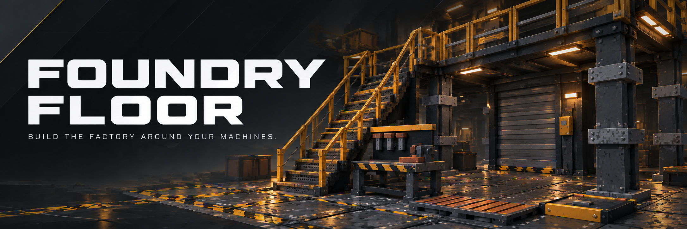
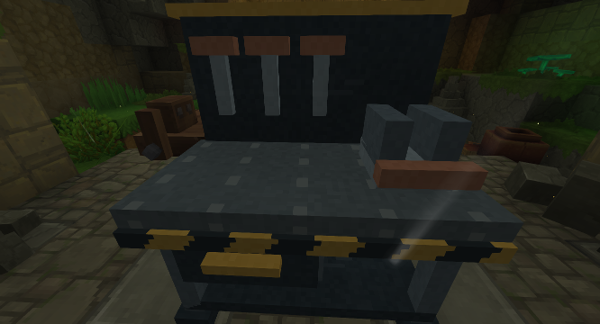
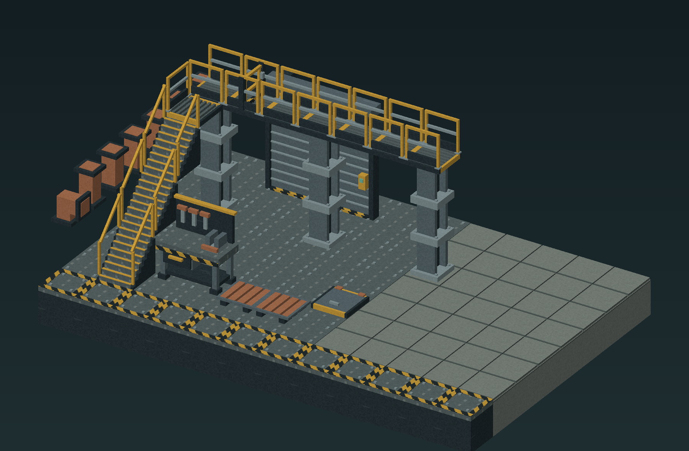

# Foundry Floor

[Player guide](https://jkswoods.github.io/foundry-floor/) · [Download the alpha](https://github.com/jkswoods/foundry-floor/releases)



Build industrial factories with modular floors, connected catwalks, structural blocks, lighting and working doors and shutters.



*Earlier native design view: Foundry Floor on Hytale 0.7.2. Current 0.7.3 world and crafting captures are still pending.*

- A dedicated **Foundry Workbench** and **27 factory blocks**.
- Connected steel grates, catwalks, wider stairs and safety edges.
- Steel frames, walls, roofs and windows for the factory shell.
- Doors, shutters, a service hatch and guarded industrial lights.

Craft the bench at a stock Workbench with **8 Iron Ingots and 4 Copper Ingots**. Its five tabs group Floors, Walkways, Structure, Fixtures and Mechanisms. Ducts and vents are architectural props.

[Install](https://jkswoods.github.io/foundry-floor/hytale0.7/installation/) · [Build your first bay](https://jkswoods.github.io/foundry-floor/hytale0.7/getting-started/) · [Recipes](https://jkswoods.github.io/foundry-floor/hytale0.7/recipes/) · [Mechanisms](https://jkswoods.github.io/foundry-floor/hytale0.7/features/mechanisms/)

## Build at factory scale



*Original model render of the building collection. It is separate from the native gameplay capture above.*

## Development status

This development support line targets Hytale 0.7 / Java 25. Player testing covered crafting, placement, mechanical controls, normal save/reload, sounds and multiplayer. Automated checks cover recipe registration, collision bounds and older-world compatibility. Keep matching world/player backups; this prerelease does not promise compatibility with other game versions or every mod combination.

Elevators, guide extensions and call panels are deferred to a future release. Older placed parts remain inert and owner-dismantleable, with no controls, passenger movement or empty-shaft reservation. They cannot be crafted or placed again.

Choose a download whose declared game-patch requirements include your installed Hytale version. No redistribution license has been selected; third-party notices remain in [THIRD_PARTY_NOTICES.md](THIRD_PARTY_NOTICES.md).

## Build

Supply a separately installed JDK 25 and the official Hytale 0.7.3 server JAR. Neither game binaries nor stock assets are redistributed.

```sh
FF_JAVA_HOME=/path/to/jdk25 FF_SERVER_JAR=/path/to/HytaleServer.jar bash tools/build.sh
```

The build runs focused core and pinned native collision checks, compiles the plugin and writes the mod JAR under `build/libs/`, printing its filename with deterministic ZIP ordering/timestamps. The checked-in native assets are sufficient for the main build; it does not regenerate audio. Run `bash tools/build.sh --core` for the core tests alone.

## Authoring and documentation

`tools/build_models.py` and `tools/build_connections.py` generate the original active assets; `tools/retire_elevator.py` maintains inert compatibility records. Editable Blockbench models and part specifications are in `art/source/`; runtime assets are in `assets/`. One block is32 model units. Python authoring uses Pillow and NumPy. The active authoring kit contains28 craftable designs,150 connection variants and8 mechanism clips.

Runtime sound families were generated through the connected ElevenLabs Sound Effects workflow. Sanitized selected-take metadata is in `assets/SOURCE-AUDIO.json`; raw recordings and private development evidence are excluded from the repository.

The [versioned player guide](https://jkswoods.github.io/foundry-floor/) is maintained on the separate [`docs` branch](https://github.com/jkswoods/foundry-floor/tree/docs). In that checkout, run `npm ci --ignore-scripts`, `npm run build` and `npm run check`. Select `docs` when manually dispatching its Pages workflow.

`python3 tools/package_authoring.py` creates the separate editable model kit. The legacy development-bundle helper accepts an independently built guide archive from `docs`. These ZIPs are not game mods.

Back up worlds and player data with matching JARs. The support branch’s reader migrates older ownership records and retains earlier FFR1–FFR4 records, including retired content. To downgrade, restore the matching complete backup rather than changing the JAR alone.

## Compatibility and builds

Current source targets Hytale `>=0.7.3 <0.8.0` and uses the `hytale0.7` support branch. See [build and release instructions](https://jkswoods.github.io/foundry-floor/hytale0.7/build-and-release/) for the SDK pin, candidate checks, versioned filenames and CurseForge workflow.

## Contributing

See [the contribution guide](CONTRIBUTING.md) for feature and bug-fix PR targets.
Maintainers handle forward/back ports, and support-branch PRs require owner approval.

The player guide follows the Hytale support line and is updated independently of mod releases. Select downloads by their game compatibility and read the selected file’s release notes for included changes and artifact checksums.
