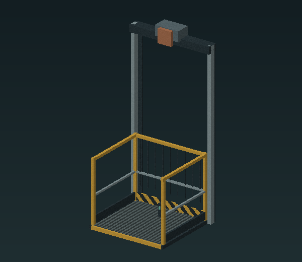

# Freight lift and call panels

**Experimental: passenger transport is not yet verified.** The current source implements bounded cab collision poses and native passenger velocity, but a successful loader or animation render does not establish safe riding. Keep this feature in a separate test world.

## Layout

The craftable **Caged freight elevator** places a controller pedestal. Its complete lift assembly is three blocks behind the pedestal, according to placement rotation. Clear a **3 × 3 × 7-block shaft** there, plus the console's own space. The fixed guides and motor remain in place while the cab moves three blocks between lower and upper docks.

*Original full-assembly render; the controller, in-game collision and passenger journey still need native screenshots and verification.*

The lower deck is one eighth of a block above the shaft's base. The upper dock is exactly three blocks higher. Build landings outside the shaft reservation. Guide extensions are architectural additions; they do not add stops or increase travel.

## Controls and access

The owner uses the controller or cab to request the opposite stop. A second request during travel is ignored. The front travel gate closes for movement and opens only at a dock. Nearby **Lift call panels** link on first use to the closest owned lift within twelve blocks. A panel at the upper landing calls the upper dock; a lower panel calls the lower dock. If two lifts are equally close, move the panel nearer its intended lift. Remove and replace a panel to change its saved link.

Passengers must stand inside the cab before a trip. The implementation allows up to eight registered passengers, but actual passenger and multiplayer support are pending verification. No power or fuel is required.

## Held and disabled states

The controller can be Lowered, Raising, Raised, Lowering, Blocked or Disabled. Obstruction holds the cab at its last committed height. Unloaded space, lost passenger support, a disconnected passenger or an excessive tick delay disables movement. A normal reload does not resume a trip automatically.

After clearing a blockage, use the owner control to request a dock again. A saved offline passenger must return before the platform can leave them behind. Do not remove the internal cab block independently. Lower and empty the lift, then let its owner remove the controller pedestal; this removes its matching assembly and returns the craftable kit through normal block removal.

Collision, passenger carrying, interruption/recovery, removal, audio loops and multiplayer behaviour all remain native acceptance requirements for this preview.
