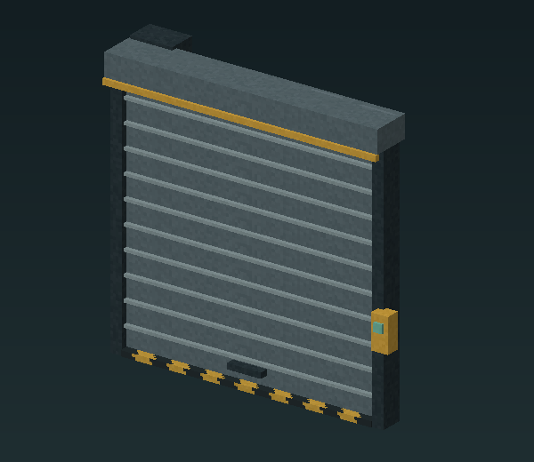

# Doors, shutters and lighting

The server-side controls below are implemented; native input, collision and save/reload acceptance are still in progress.

| Block | Use action | Space to leave clear |
| --- | --- | --- |
| Rolling loading-bay shutter | Retracts or closes eleven slats | Full curtain opening, guides and overhead hood |
| Hinged catwalk safety gate | Opens or closes around the left hinge | Gate swing and approach |
| Factory personnel door | Opens or closes the steel panel | Door swing and two-block doorway |
| Floor service hatch | Raises or lowers the deck around its rear hinge | Swing above the hatch and the opening below |
| Guarded factory lamp | Toggles the light | Housing and wall bracket |

*Original model render. A native open/closed usage screenshot is pending.*

Use the normal **Use** action while looking at a mechanism from within eight blocks. Only its placing owner can operate or remove it. Wait for a shutter's motion to finish before toggling again; other controls also have a brief cooldown.

The controller refuses changes when the reserved movement space is blocked. It checks the destination collision against nearby entities before changing solid mechanisms. Light toggling changes the native light state. Accepted control states and ownership are saved with the world.

Original generated sound effects are requested after accepted changes. They still need human listening and distance/repetition checks. If a control does not respond, see [troubleshooting](../troubleshooting.md).
