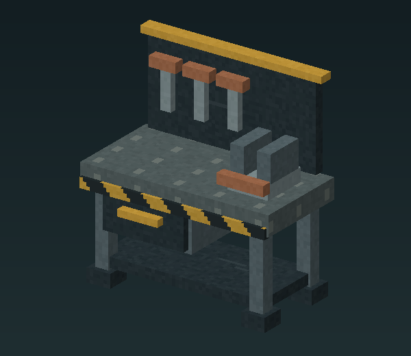

# The Foundry Workbench

The Foundry Workbench is a separate crafting bench for the factory collection. Its original model has a steel worktop, shelf, drawer, vice and hanging tools.

*Original model render. A current-build native crafting screenshot is still pending.*

## Make the bench

At a standard **Workbench**, use **8 Iron Ingots + 4 Copper Ingots** to craft **1 Foundry Workbench**. Earlier native server transactions verified this cost and the original 25 factory recipes. The current registry contains 27 factory recipes, with the five new pieces under playtest. Opening a placed Foundry Workbench has also been tested in game. The complete player crafting UI and timing remain under test.

The bench's top spans nearly two blocks and its tool board rises above one block. Leave adjoining cells and overhead space clear. Rotate it before placing so the vice and drawer face your working area.

## Five tabs

| Tab | What you make |
| --- | --- |
| Floors | Steel plate, safety edge, concrete and drain grate |
| Walkways | Open and railed catwalks, corners and stairs |
| Structure | Rails, columns, crossbeams, guide extensions, walls, roof and windows |
| Fixtures | Utility ducts, vents, lights and pallets |
| Mechanisms | Shutter, gate, personnel door and hatch |

Every factory recipe currently uses Iron Ingots and takes two seconds. Output quantities vary; consult the [full recipe table](../recipes.md). There are no bench tiers or upgrades in this version.

The bench uses original generated workshop sounds for opening, closing and completed crafts. Human listening approval remains pending.
