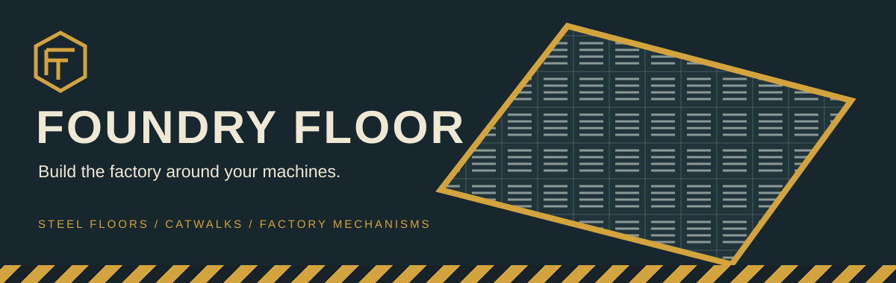

# Foundry Floor

Steel floors, grated walkways, bolted frames and industrial mechanisms for a factory that feels built to work in. Foundry Floor adds a dedicated **Foundry Workbench** and **25 factory blocks**, with a shared steel, brass and safety-yellow palette.

<strong>0.1.0 development preview · Hytale 0.7.2</strong> The native assets, crafting registry and server plugin load successfully. In-game crafting, controls and passenger lift travel are still undergoing verification. There is no tested playable download yet. Use a separate test world.

Start with [installation](installation.md) and the [first factory bay](getting-started.md). The [recipe table](recipes.md) lists every configured input and output. The collection complements your machines; its ducts and vents are architectural props.

## A workshop for factory building

The Foundry Workbench groups the collection into **Floors, Walkways, Structure, Fixtures and Mechanisms**. Its configured starting recipe is **8 Iron Ingots + 4 Copper Ingots** at a standard Workbench. Factory blocks then use Iron Ingots at the new bench. There is no power, fuel or research tree.

## Build at two scales

Use full-height plates and concrete for the main floor. Add thin catwalk decks, stair flights and rails above it. Columns, crossbeams, vents and utility ducts turn a machine room into a convincing factory interior. Shutters, doors, a maintenance hatch and guarded lights provide the mechanical details.

The experimental freight lift has a three-block travel range, fixed guides, a caged cab and nearby call panels. Its passenger behaviour is not yet verified; see the [lift page](features/lift.md) before testing it.

The [source repository](https://github.com/jkswoods/foundry-floor) is private. Links require access to that repository. This project is an independent mod and is not an official Hytale product.
